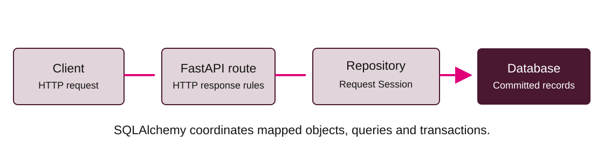

# Exercise 2: CRUD API

Build on Exercise 1 to finish the equipment API's reads, replacement and deletion.
The guided start and supported practice lead to a partially independent core
finish: you will design DELETE end to end and add a write/read integration check.

Work from the `exercises/` directory and use the environment and database setup
from [Exercise 1](exercise-1.md). Stop the development server before changing
schema or migration files.

Your implementation files are `app/repository.py`, `app/main.py` and
`tests/test_crud.py`. Keep the existing route signatures and assertions.

## CRUD API practical — 65 minutes



The route owns HTTP responses. The repository uses the request Session to read or
commit rows, and the database retains committed records across requests.

### C1: Guided read — 10 minutes

Trace the worked POST from route to `create_equipment`, Session commit and
response. Implement `get_equipment` using the primary-key ORM pattern from
Exercise 1. The GET route already handles `None` with 404. Run the server and
create then read a record in Swagger UI. The schemas describe HTTP data; the ORM
class maps a database row.

### C2: Supported listing — 15 minutes

Implement `list_equipment`: build
`select(Equipment).order_by(Equipment.id)` and use
`session.scalars(statement).all()`. Return a list, including `[]` when empty.

```bash
python -m pytest tests/test_crud.py -k create_read -q
```

### C3: Supported replacement — 15 minutes

Implement `update_equipment` and the PUT route. Look up the id, return 404 if
missing, assign **all** write fields and save/commit. The contract uses full PUT
replacement of name/category/location. An omitted location becomes null. Keep the
existing id. Repository code handles data; route code chooses HTTP status.

### C4: Partially independent core task — 10 minutes

Implement DELETE end to end. Decide the lookup, database operation, transaction
boundary and route response yourself. Use the contract below. This task is
required. There is no prescribed line-by-line solution.

### C5: Integration evidence — 15 minutes

Complete `test_student_write_then_read` in `tests/test_crud.py` using a different
equipment example. Assert creation, a generated id and a later GET value. The
provided fixture uses Alembic on a fresh temporary SQLite file and overrides the
request Session. No test uses your development database.

```bash
python -m pytest tests/test_crud.py -q
```

Also restart the development server and GET an earlier record to show file
persistence.

| Contract | Success | Missing record |
|---|---|---|
| POST /equipment | 201 and object with generated id | N/A |
| GET /equipment | 200 and array | Empty array |
| GET /equipment/{id} | 200 and object | 404 |
| PUT /equipment/{id} | 200 and replaced object | 404 |
| DELETE /equipment/{id} | 204 and no body | 404 |

Example write body: `{"name":"Camera","category":"media","location":"A1"}`.
Read adds `"id": 1` (actual ids vary). Validation depth is a later lesson.

## Hints and troubleshooting

| Symptom | Check and next action |
|---|---|
| PUT returns old values | Check that the replacement assigns all fields and commits |
| 204 response has content | Return `Response(status_code=204)` after a successful delete |
| CRUD checks fail before their milestone | Complete the matching TODO; the scaffold intentionally leaves core operations unfinished |

Identify whether a failure is in the HTTP contract, query, transaction or schema.
Inspect the smallest failing test and compare it with the worked POST path. Keep
the existing assertions and use the temporary test database supplied by the
fixture.

Continue to [Exercise 3](exercise-3.md) for cache-aside reads and invalidation.
