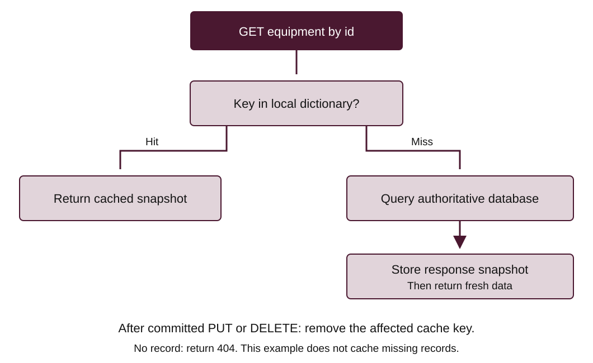

# Exercise 3: Local dictionary caching

Add a small cache-aside path for GET `/equipment/{id}`. The database remains
authoritative and the cache is a disposable copy. Complete Exercises 1 and 2
first.

Work from the `exercises/` directory and use the setup from
[Exercise 1](exercise-1.md). Spend 10 minutes tracing a miss then a hit, 20
implementing and 10 checking.

Implement cache reads and invalidation in `app/main.py`; use the supplied
`tests/test_cache.py` as a check without weakening its assertions.



The diagram shows the required behaviour, not its code. Follow the hit and miss
branches.

## Implement and check

Cache only GET `/equipment/{id}`. Use the existing application dictionary,
integer ids as keys and **plain response dictionaries** as values, not
Session-bound ORM objects.

1. If the key exists, return its data and set `X-Cache: hit` on
   `response.headers`.
2. Otherwise fetch the row, return 404 if missing, build a plain dictionary,
   cache it and set `X-Cache: miss`. Do not cache missing records in this
   exercise.
3. After a successful committed PUT or DELETE, remove only that id using
   `cache.pop(equipment_id, None)`. Do not invalidate before a failed
   transaction.
4. POST does not need per-item invalidation because a new generated id has no
   cached entry. If caching lists instead, POST would affect those lists.

Predict then verify: miss, hit, PUT, miss with updated value, hit, DELETE, 404.

```bash
python -m pytest tests/test_cache.py -q
python -m pytest -q
```

Run the complete suite after finishing the CRUD and cache milestones. Explain why
a hit need not execute a SELECT even though a request Session is supplied.

## Scope and troubleshooting

This is one local process, one dictionary and sequential lab requests; no TTL or
Redis is required. Restarting clears the cache but retains committed database
rows. Each worker would have a different cache. Concurrent read/write races,
eviction, bounded memory and distributed invalidation need more design before
production. TTL only limits how long an entry may survive; it does not guarantee
fresh reads. Observe hit/miss and freshness, not an invented speed-up claim.

| Symptom | Check and next action |
|---|---|
| Old values after PUT | Check the commit succeeds, then invalidate the integer cache key |
| Deleted row remains readable | Confirm successful DELETE invalidates the id and a later GET returns 404 |
| Cache test fails | Check plain dictionary snapshots, integer keys and `X-Cache` values |

## Minimum catch-up and teardown

If you missed a class, first complete Exercise 1 P1–P4, then Exercise 2 C1 and
one create/read integration check. Next complete Exercise 2 C2–C4 and this
exercise's cache behaviour. Ask the lecturer for help with the exact command,
error and hypothesis.

Stop servers with Ctrl+C. Keep your work and migration history. No cloud cleanup
is needed.
